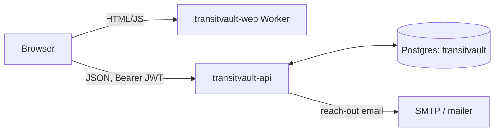
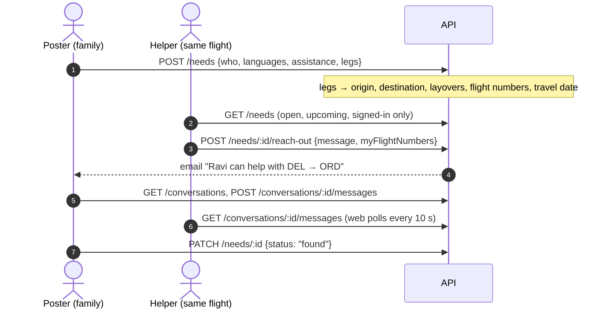

# TransitVault: how it works

A needs board for elderly parents flying alone. A family member posts the trip ("my mother, 68, Hindi/Punjabi, DEL → FRA → ORD on 1 Dec, LH761 + LH430, needs a wheelchair at Frankfurt"). Other signed-in users browse the board. Anyone on a matching flight reaches out with a message, which opens a private conversation. People share phone numbers there when they choose to.

Phase 1 deliberately has **no money, no uploads, no verification and no live tracking**.

## Stack (same as the other org apps, minus what Phase 1 doesn't need)

| Layer | What | Where |
|---|---|---|
| Web | Next.js 16, React 19, Tailwind 4, lucide | Cloudflare Workers (`transitvault.3pandalabs.com`) |
| API | Fastify 5 + Zod + JWT | Coolify on the Hetzner box (`transitvault-api`) |
| Data | Postgres 17 + Drizzle | shared `3pandalabs-postgres`, db `transitvault` |
| Mail | SMTP (Gmail app password) → org mailer fallback | "someone reached out" + password reset |

There's no Temporal worker and no R2 media bucket: nothing in Phase 1 needs a timer or a file.

## Flow

## Data model

`users` (name, email, phone; one kind of account) · `needs` (traveller label/age/languages, assistance, `legs` jsonb + derived `origin`, `destination`, `layovers[]`, `flight_numbers[]`, `travel_date`, status `open|found|closed`) · `conversations` (one per need + helper, helper's flight numbers) · `messages` · `sessions`, `password_reset_tokens`.

## Privacy

- The board is signed-in only: a need describes an elderly person travelling alone.
- The API never returns phones or emails to other users. The board shows the poster's first name only, and the UI tells people not to post full names or passport details.
- Conversations are visible only to their two parties (404 for anyone else). A closed need is visible only to its owner.

## Phase 2

- **Filters** on the board: from, to, via (layover), date ±1 day, flight number, language. The indexes are already in place: GIN on `flight_numbers` and `layovers`, btree on `(origin, destination, travel_date)`.
- **Helper posts**: "I'm flying DEL → ORD on 1 Dec, happy to help", the mirror image of a need.
- Later, only if wanted: reporting/blocking, verified profiles, live journey updates.
